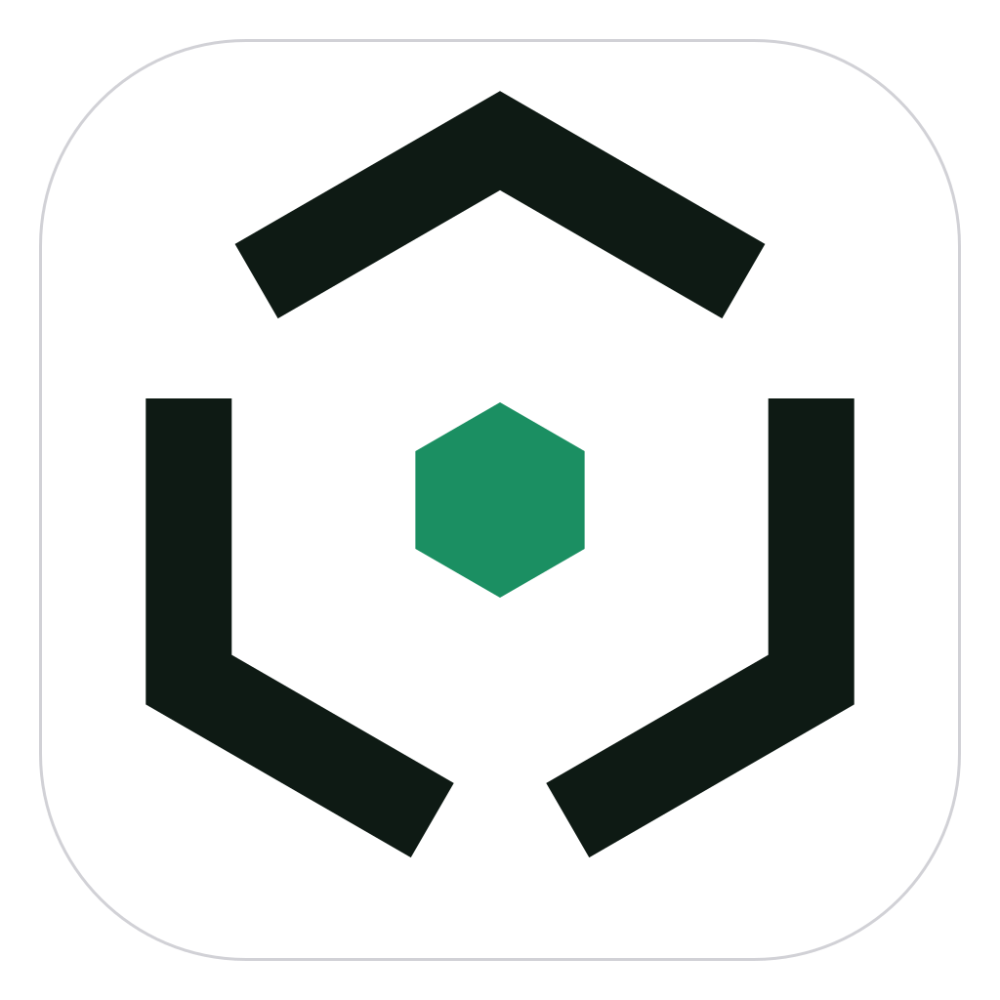

<p align="center">
  
</p>

# OsmiumIDE (Osmium)

> A calm, powerful desktop IDE and multi-CLI orchestrator that drives the coding CLIs you already pay for (Codex CLI, Antigravity, DeepSeek CLI, and others) from one place.

[](#quick-start)
[](LICENSE)
[](tsconfig.base.json)
[](apps/desktop)

---

## What is OsmiumIDE?

Developers subscribe to multiple AI coding tools—Codex, Antigravity, DeepSeek, and others—each with their own CLI, auth, quotas, and context. **OsmiumIDE** unifies them into a single, cohesive desktop IDE:

1. **Official CLIs Only (No API Keys Needed)**: Runs provider CLIs as local child processes. Credentials and sessions remain managed by each CLI. Zero token storage or forwarding.
2. **Everyday IDE**: Monaco editor workbench, lazy file explorer, integrated terminals (`node-pty` + xterm.js), ripgrep project search, and full Git source control with inline hunk review.
3. **Pre-Turn Checkpoints & Instant Undo**: Every agent action is snapshotted under `refs/osmium/checkpoints/<id>` before changes touch disk, enabling exact one-click rollbacks without polluting your git branches.
4. **`/teamwork` Multi-CLI Orchestrator**: The primary CLI breaks goals into structured tasks; tasks run in isolated git worktrees (`.osmium/worktrees/`) assigned across CLIs, followed by structured diff review and clean merge.
5. **Quota Fallback**: When one subscription hits its usage limit, tasks can automatically or manually transition to the next CLI in the project's secondary list.
6. **Local-First & Private**: Project metadata lives in `.osmium/project.yaml` and a local SQLite database (`.osmium/osmium.db`). No cloud accounts or telemetry required.

---

## Monorepo Architecture

OsmiumIDE is organized as a high-integrity `pnpm` monorepo:

```
Osmium/
├── apps/
│   └── desktop/            # Electron main, typed preload bridge, React 19 + Vite renderer
├── packages/
│   ├── core/               # Contracts, Zod schemas (preserves unknown YAML keys), session engine
│   ├── ide-core/           # Typed IPC contracts, command registry, workspace & file services
│   ├── adapters/           # Adapter contract re-exports, fixed CLI color palette, version warnings
│   ├── ui/                 # Soft-green design tokens, bundled Inter fonts, accessible React UI
│   └── mock-cli/           # Standalone executable CLI for deterministic tests & E2E scenarios
├── docs/
│   ├── PLAN.md             # Authoritative 7-phase build plan & Section 13 IDE core spec
│   ├── PROGRESS.md         # Living progress tracker, CLI probe records, and Phase reports
│   ├── HANDOFF.md          # Master handoff document for the next AI / developer session
│   └── design/             # Reference design screenshots (Home, Session, Board, IDE, Source Control)
├── e2e/                    # Playwright Electron smoke test & 4-tier E2E testing harness
└── scripts/
    ├── ci.sh               # Full verification pipeline (build + typecheck + lint + test + e2e)
    └── run-e2e.mjs         # Cross-platform E2E runner (auto-wraps in xvfb on headless Linux)
```

---

## Quick Start

### Prerequisites

- **Node.js**: `v22.x` or `v24.x` (verified on `v24.22.2 LTS`)
- **pnpm**: `v10.x` or `v12.x` (managed via Corepack)
- **Git**: `>= 2.30`

### Installation & Build

```bash
# Install workspace dependencies
pnpm install

# Build all workspace packages and desktop assets
pnpm run build
```

### Development

```bash
# Launch Electron desktop application in development mode
pnpm run dev
```

### Testing & Verification

```bash
# Strict TypeScript typecheck across all packages
pnpm run typecheck

# ESLint & Prettier code style check
pnpm run lint
pnpm run format:check

# Unit and integration tests (Vitest)
pnpm test

# Cross-platform Electron Playwright smoke tests
pnpm test:e2e

# Full automated CI gate
pnpm run ci
```

---

## Project Status

- **Phase 0 (Monorepo Scaffold & App Shell)**: **COMPLETE & VERIFIED**.
  - All workspace packages scaffolded and built.
  - Strict TypeScript, ESLint, Prettier, Vitest, and Playwright configured and passing.
  - App shell faithfully matches reference specifications (`Home.png`).
  - Unit tests (26/26) and Playwright Electron smoke tests pass in CI.
- **Next Phase: Phase 1 (One CLI, One Chat)**:
  - CLI detection service & CLI Hub screen.
  - Mock and Codex adapters.
  - SQLite persistence (`better-sqlite3`).
  - Streaming chat UI with cancel and error states.

For full phase breakdown, see [docs/PLAN.md](docs/PLAN.md) and [docs/PROGRESS.md](docs/PROGRESS.md). For AI orchestrator instructions, see [docs/HANDOFF.md](docs/HANDOFF.md).

---

## License

This project is licensed under the **GNU General Public License v3.0** — see the [LICENSE](LICENSE) file for details.